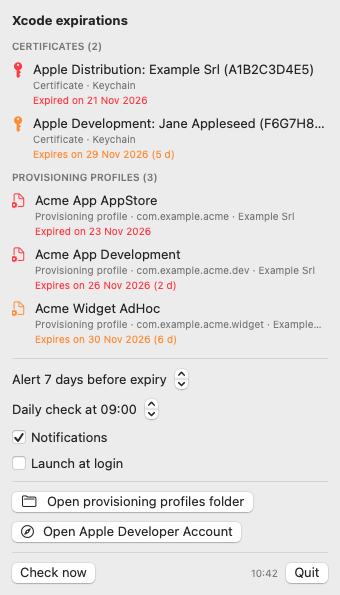
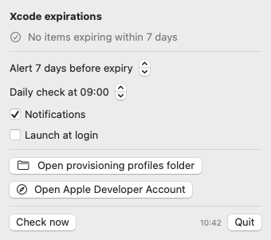
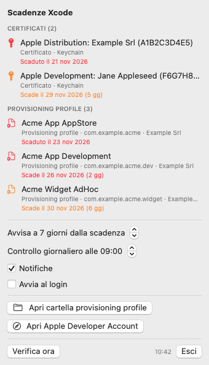
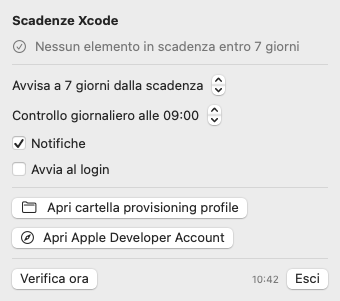

# Certy Pie 🥧

Menu bar app for macOS that watches the **code-signing certificates** and **provisioning profiles** used by Xcode, and warns you before they expire.

| Expiring items | All good |
|---|---|
|  |  |
|  |  |

The UI follows the system language (English and Italian).

## Features
- Lives in the menu bar; the icon turns orange with a counter when something is expiring.
- Checks every day at 9:00 (configurable), or as soon as possible if the Mac was off/asleep.
- Configurable threshold (default 7 days); expired items are always listed.
- Lists certificates (Keychain signing identities) and provisioning profiles with name, bundle ID, team and expiry date.
- Shortcuts to the provisioning profiles folder and to the Apple Developer account page.
- Optional notifications and launch at login.

## Build
Requires macOS 13+ and the Swift toolchain (Xcode or Command Line Tools).

```bash
./build.sh
open "build/Certy Pie.app"
```

Debug helpers: `CertyPie --dump` prints the scan to stdout; `CertyPie --screenshots <dir>` renders the README images with fake data.

## Privacy
Certy Pie runs entirely on your Mac and makes no network connections (no analytics, no crash reporting).

- It reads the code-signing certificates in your Keychain (name, expiry date and serial number only; private keys are never accessed) and the provisioning profiles in `~/Library/MobileDevice/Provisioning Profiles` and `~/Library/Developer/Xcode/UserData/Provisioning Profiles` (profile name, team name, bundle ID, expiry date). It never writes to the Keychain or to the profiles.
- This data is kept in memory only. The only thing stored on disk is the settings (alert threshold, check hour, notifications on/off) in UserDefaults.
- Notifications contain only counts, never names.
- "Open Apple Developer Account" simply opens https://developer.apple.com/account in your default browser.
- The popup shows company, team and personal names, and `CertyPie --dump` prints them to stdout: hide the popup when screen sharing and redact the output before sharing it.

The app is not sandboxed (the sandbox would block access to the profiles folder and the Keychain identities).

## Distribution notes
Build locally with `./build.sh` (the app is ad-hoc signed, which is fine for a local build). A downloaded unsigned/un-notarized copy is blocked by Gatekeeper: allow it in System Settings → Privacy & Security → Open Anyway. For "Launch at login", keep the app in `/Applications`.

## License
[MIT](LICENSE)
